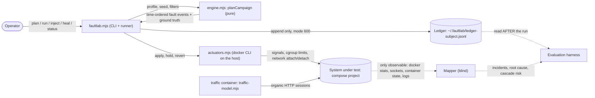
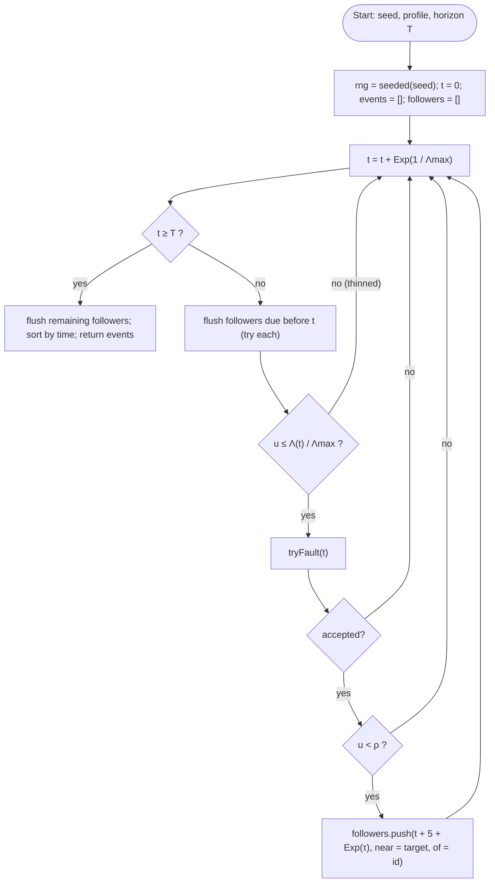
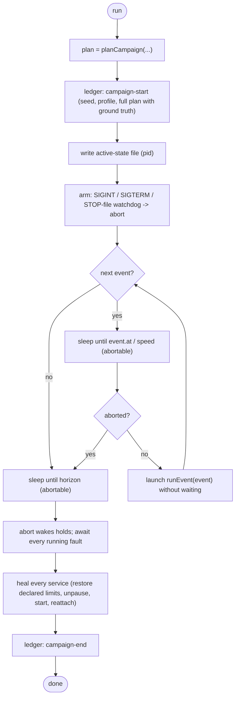
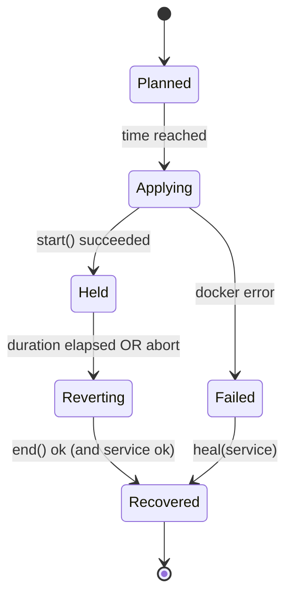
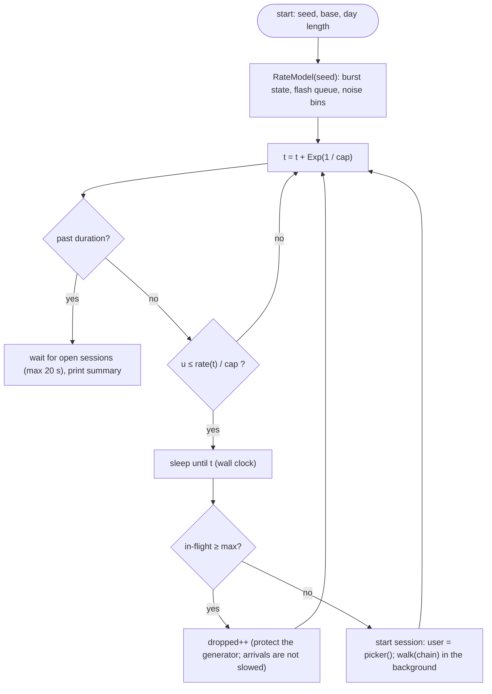
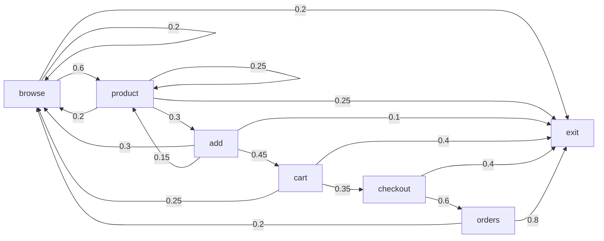

# Fault injection and organic traffic: algorithm, model and manual

This is the specification of the two engines that drive the benches (ShopFlow and LedgerLine):

* **faultlab** (`lab/faultlab/`): an organic, reproducible, **mapper-blind** fault injector with manual controls.
* **traffic model** (`<subject>/loadgen/traffic-model.mjs`): an open-loop visitor generator (daily wave, bursts, flash crowds, Markov sessions).

Together they make a bench behave like a small production system that has real incidents, while the system under test (and
the mapper that watches it) is given no hint about what is going to happen or when.

Contents: [1 Principles](#1-design-principles) · [2 Architecture](#2-architecture) · [3 Blindness](#3-what-makes-it-mapper-blind) ·
[4 Mathematical model](#4-mathematical-model) · [5 Planner](#5-algorithm-1-the-campaign-planner) · [6 Runner](#6-algorithm-2-the-runner) ·
[7 Actuators](#7-algorithm-3-actuators-one-per-fault-class) · [8 Traffic](#8-algorithm-4-organic-traffic) ·
[9 Operator manual](#9-operator-manual) · [10 Ledger](#10-the-ledger-ground-truth) · [11 Scoring](#11-scoring-a-mapper-against-the-ledger) ·
[12 Validation and limits](#12-validation-and-known-limits)

---

## 1. Design principles

| Principle | What it means in the code |
|---|---|
| **Organic** | Faults arrive as a random process whose rate follows the day's load; durations are heavy-tailed; some faults come in pairs ("an incident during an incident"); cascades are **not scripted**: they emerge from the real dependencies because the faults are real. |
| **Blind** | The mapper never learns the plan, the seed, the timing or the classes. Nothing is installed, labelled or logged inside the system under test. |
| **Reproducible** | One seed gives one plan (`engine.mjs` is pure). A campaign that surprised you can be replayed exactly. |
| **Controllable** | An operator can pick a profile, restrict classes/targets, change every rate, run blind, dry-run, or inject one fault by hand with its own parameters. |
| **Safe** | Concurrency cap, per-service cooldown, blast-radius budget, protected services, a STOP file watchdog, healing on exit/Ctrl-C, and healing that restores the *declared* configuration. |
| **Auditable** | Every fault is written to a private ledger with its ground truth (root cause and who should be affected). The ledger is what the mapper is scored against. |

---

## 2. Architecture



Everything on the left of the dotted lines is invisible to the mapper. The two dotted arrows into the evaluation harness are
the only place where plan and prediction meet, and they meet after the fact.

---

## 3. What makes it mapper-blind

| The mapper CAN observe | The mapper CANNOT observe |
|---|---|
| Container state (running, paused, exited, restarting) and restart counts | The plan, the seed, the profile or the campaign horizon |
| CPU, memory, network counters, PIDs of every container | Which fault classes exist and their weights |
| TCP connections between containers; HTTP responses it probes | Fault labels: nothing is added to container labels, env, volumes or logs |
| The consequences of a fault: latency, errors, silence, dependants failing | The ledger (a private file on the bench host, outside every container) |
| | Whether a symptom is caused by a fault, by traffic, or by nothing |

Rules that keep it that way:

1. The injector runs on the **host**, not in a container, and addresses containers by compose labels that already exist.
2. Faults are physical: `SIGKILL`, `SIGSTOP`-equivalent pause, cgroup CPU/memory limits, network disconnect. There is no
   special endpoint, header, marker file or log line that would let a tool "detect the injector" instead of the fault.
3. The traffic generator has no knowledge of faults. It does not slow down, retry harder or stop when something breaks (open loop).
4. `--blind` hides the plan from the operator too: only the ledger holds it, for a second person to score afterwards.
5. Manual injections are written to the same ledger, so they are scoreable like any other fault.

---

## 4. Mathematical model

### 4.1 Fault arrivals

Faults begin according to a **non-homogeneous Poisson process** with intensity

```
Λ(t) = λ0 · ( 1 − κ + κ · D(t) / D̄ ),       D(t) = 0.55 + 0.45 · sin(2π t / P)       D̄ = 0.55
```

* `λ0` base rate (`ratePerMin / 60`), `κ ∈ [0,1]` load coupling (how much faults favour busy times), `P` the length of one "day".
* Expected number of arrivals in `[0, T]`: `E[N] = ∫₀ᵀ Λ(t) dt = λ0 · T` when `T` is a whole number of days (the coupling term integrates to zero).
* Realised by **Lewis–Shedler thinning**: draw candidate times from a homogeneous process of rate `Λmax = λ0 (1 − κ + κ / D̄)`, keep a
  candidate at time `t` with probability `Λ(t) / Λmax`.

### 4.2 What a fault is

For an accepted arrival at time `t`:

| Part | Distribution |
|---|---|
| Class `c` | Categorical, weights `w_c` (table below) |
| Target `s` | Categorical over eligible services, weight `h_s · m(role_s, c)`: hazard × role multiplier |
| Duration `d` | `LogNormal(median_c, σ_c)` clipped to `[d_min, d_max]` (incident lengths are heavy-tailed) |
| Severity `v` | `Beta(α_c, β_c)`; maps to a CPU quota `q = max(0.05, 1 − 0.95 v)` or a memory squeeze |
| Onset shape | step, or **ramp** over `r ~ U[20, 90] s` (gradual degradation) for brownouts (probability 0.4) |
| Intermittency | `flap`: period `U{6..20} s`, frozen fraction `Beta(2,2)` clipped to `[0.2, 0.8]` |
| Crash loop | `K ~ U{3..8}` kills, gap `LogNormal(12 s, 0.4)` clipped to `[6, 40]` |

| Class | Weight | Effect | Duration median (σ, range) |
|---|---|---|---|
| `crash` | 0.18 | SIGKILL; restart policy (or an orchestrator) brings it back | recovery about 20 s |
| `crash-loop` | 0.06 | killed again each time it comes back | `(K−1)·gap + 20 s` |
| `stop` | 0.12 | stopped (connection refused), then started | 75 s (0.7, 20–600) |
| `pause` | 0.18 | process frozen: connects, never answers (timeouts) | 60 s (0.6, 15–420) |
| `brownout` | 0.22 | CPU throttled: slow, not dead (gray failure) | 150 s (0.6, 40–900) |
| `memory` | 0.06 | memory limit squeezed to just above the working set | 150 s (0.6, 40–900) |
| `partition` | 0.10 | detached from the network | 50 s (0.6, 15–300) |
| `flap` | 0.08 | frozen/running in turns | 100 s (0.5, 40–400) |

### 4.3 Compound faults (a one-generation branching process)

With probability `ρ` an accepted fault spawns a **follower** after `5 + Exp(τ)` seconds. The follower's target is drawn from the
parent's one-hop neighbourhood `N(p) = deps(p) ∪ callers(p)` with probability `q` (default 0.6), otherwise from all services. This
reproduces the real pattern where trouble next to trouble is likelier, and it is what makes root-cause ranking non-trivial.

### 4.4 Safety constraints (rejection rules)

A candidate is rejected (and counted in `blocked`) if any holds:

1. `|active(t)| ≥ K` (at most `K` concurrent faults).
2. The target is protected, already faulted, or inside its cooldown `end + cooldownSec`.
3. **Blast budget:** let `R(s)` be the set of services that depend on `s`, directly or transitively, plus `s` itself. Reject if
   `| ⋃_{u ∈ active ∪ {s}} R(u) | / |S| > B`. This prevents plans that take down so much of the system that no tool could be judged on it.

### 4.5 Ground truth

For fault `f` on service `s`: `rootCause(f) = s`, `expectedAffected(f) = R(s) \ {s}` (the transitive callers), and
`blastShare(f) = |R(s)| / |S|`. The traffic generator is excluded from `S` (it is not part of the system under test).

### 4.6 Traffic

Visitor sessions arrive by another non-homogeneous Poisson process, **open loop**:

```
λ(t) = min( cap,  base · D(t) · B(t) · F(t) · N(⌊t/5⌋) )
```

| Factor | Model |
|---|---|
| `D(t)` | the same daily wave as above (faults and load can be coupled) |
| `B(t)` | two-state Markov-modulated process (MMPP): calm (×1) and busy (×`mult`), exponential holding times (defaults 240 s calm, 40 s busy) |
| `F(t)` | flash crowds: Poisson arrivals (default 3/h), each adds `A·exp(−(t−tᵢ)/τᵢ)` with `A ~ U[1.5, 4]`, `τ ~ U[45, 180] s` (sudden rise, slow decay) |
| `N` | multiplicative `LogNormal(0, 0.12)` noise per 5-second bin |

Each session walks a **Markov chain** over pages with lognormal think times (`LogNormal(1.5 s, 0.8)`, capped at 20 s). Product
popularity is Zipf(1.1); users are *returning* (Zipf over the user base) with probability 0.6, else new.

---

## 5. Algorithm 1: the campaign planner

`planCampaign({catalog, profile, seed, horizonSec, periodSec, only}) → events[]`. Pure: no clock, no docker, no files.



```text
function planCampaign(catalog, profile P, seed, T, period, only):
    rng        ← Seeded(seed)
    S          ← services of catalog that are not protected         # the system under test
    reach      ← transitive callers of every service                 # blast radius R(s)
    Λmax       ← λ0 · (1 − κ + κ / D̄)
    events ← [];  followers ← [];  lastEnd ← {};  blocked ← 0

    function tryFault(t, near, parent):
        active ← { e in events : e.start ≤ t < e.start + e.duration }
        if |active| ≥ P.maxConcurrent:  blocked++;  return ∅
        repeat up to 6 times:
            c ← Categorical(classes, w)
            pool ← eligible services
            if near ≠ ∅ and rng.u < P.neighbourProb:
                pool ← pool ∩ ( deps(near) ∪ callers(near) )   (if non-empty)
            cand ← { s in pool : s ≠ near, s not in active, lastEnd[s] ≤ t }
            s ← Categorical(cand, hazard[s] · roleMult[role[s]][c])
            if s = ∅:  continue
            if | ⋃ R(u) for u in targets(active) ∪ {s} | / |S| > P.blastBudget:  continue
            f ← sampleFault(rng, c)                                  # duration, severity, ramp, period, duty, kills ...
            e ← { id, at: t, target: s, ...f, compoundOf: parent,
                  truth: { rootCause: s, expectedAffected: R(s) \ {s}, blastShare: |R(s)|/|S| } }
            events.append(e);  lastEnd[s] ← t + f.duration + P.cooldownSec
            return e
        blocked++;  return ∅

    t ← 0
    loop:
        t ← t + Exp(mean = 1 / Λmax)
        if t ≥ T: break
        flushFollowers(t)                       # followers due earlier than t are attempted first, in time order
        if rng.u > Λ(t) / Λmax:  continue       # thinning
        e ← tryFault(t, ∅, ∅)
        if e ≠ ∅ and rng.u < P.compoundProb:
            followers.append( (t + 5 + Exp(P.compoundDelay), near = e.target, of = e.id) )
    flushFollowers(T)
    return sort(events by at)
```

Complexity: `O(N · (|events| + |S|))` for `N` candidate arrivals; with tens of services and hundreds of events it is instantaneous.

---

## 6. Algorithm 2: the runner



State of one fault:



```text
function runEvent(ev, ctx):
    ledger( fault-start { id, class, target, params, truth, plannedAt, startedAt = now } )
    try:    out ← actuator[ev.class].execute(ev, ctx)         # start(); during(); finally end()
    catch e: error ← e.message;  heal(ev.target)
    ledger( fault-end { id, appliedAt, healedAt, recovery, error, endedAt = now } )
```

Time compression `--speed s` divides every wait (arrival gaps, durations, gaps in crash loops) by `s`, which is how a six-hour campaign is rehearsed in a few
minutes. Real-world timing facts (docker's 10-second restart rule, the grace before a manual start) are **not** compressed.

---

## 7. Algorithm 3: actuators (one per fault class)

Every actuator has `start()`, `during(ctx)`, `end()`. `end()` always runs (in a `finally`), and before any limit is changed the original is
read from the compose file (the source of truth), so healing restores the declared configuration, not a guess.

| Class | `start()` | `during()` | `end()` |
|---|---|---|---|
| `crash` | wait until the container has been up 12 s (docker ignores restart policy for fresher ones), `docker kill` | wait for the restart policy up to 25 s; if still down, `docker start` and record `manual-start-after-25s` | none |
| `crash-loop` | as `crash` | repeat `K−1` times: wait `gap`; kill again if it is back, otherwise start it | recover as above |
| `stop` | `docker stop -t 1` | sleep `duration` | `docker start` |
| `pause` | `docker pause` | sleep `duration` | `docker unpause` |
| `brownout` | `docker update --cpus q` (step) | step: sleep; ramp: 6 steps from 1.0 to `q` over `rampSec`, then sleep the rest | restore compose CPU limit (`--cpus <host cores>` when none: `--cpus 0` is ignored by the daemon) |
| `memory` | measure usage; `docker update --memory L --memory-swap L` with `L = usage · (1.03 + 0.15 (1−v))` (the kernel refuses less than current usage; retried with +3 MB) | sleep `duration` | restore compose `mem_limit` and swap |
| `partition` | `docker network disconnect <net>` | sleep `duration` | `docker network connect --alias <service> <net>` |
| `flap` | none | until `duration`: pause for `period·duty`, unpause for `period·(1−duty)` | `docker unpause` |

`heal(service)` is idempotent: `unpause`, `start`, restore resources, reattach to the network, then **return the service's state** so a heal that did not
work is reported (`still detached ...`) instead of hidden.

---

## 8. Algorithm 4: organic traffic



```text
function rate(t):                                   # called with non-decreasing t
    advance burst state while t ≥ nextSwitch:  flip;  nextSwitch += Exp(mean of the new state)
    advance flash queue while t ≥ nextFlash:   push { t0, A ~ U(1.5,4), τ ~ U(45,180) };  nextFlash += Exp(3600 / ratePerHour)
    drop flashes older than 6τ
    return min(cap, base · D(t) · (inBurst ? mult : 1) · (1 + Σ A·exp(−(t − t0)/τ)) · noise(⌊t/5⌋))

function walk(chain, ctx, rng):
    state ← sample(chain.start)
    for i in 1..maxSteps:
        run(chain.states[state], ctx, session)            # a failing step does not end the visit
        next ← sample(chain.states[state].next)           # includes "exit"
        if next = exit: break
        sleep( min(20 s, LogNormal(thinkMs, 0.8)) )
        state ← next
```

**ShopFlow chain** (start: browse 0.83 · product 0.10 · orders 0.07):



**LedgerLine chain** (start: profile 0.45 · statement 0.20 · transfer 0.35): `profile → transfer 0.35 / statement 0.25 / fx 0.08 / profile 0.07 / exit 0.25`,
`transfer → profile 0.20 / statement 0.25 / transfer 0.15 / exit 0.40`, `fx → statement 0.3 / exit 0.7`, `statement → profile 0.1 / transfer 0.15 / exit 0.75`.
Each visit belongs to one customer account drawn Zipf(1.05) over the 2000 active payers, which creates the hot rows that make the ledger contend.

Why open loop: a closed-loop generator (N workers that wait for answers) **reduces** load exactly when the system slows down, which hides the very symptoms a mapper needs
to see. Here the arrivals are independent of service time, so a brownout produces a growing backlog, timeouts and retries, as it would in production.

---

## 9. Operator manual

```text
node lab/faultlab/faultlab.mjs <shopflow|ledgerline> <command> [options]

list                       services, roles, dependencies, what breaks if each fails, fault classes, profiles
plan                       print the campaign a seed would produce (touches nothing)       --json for machine output
run                        execute a campaign in real time (Ctrl-C or `touch ~/.faultlab/STOP` heals and stops)
inject <service> <class>   one fault by hand, held for its duration, then healed
heal [service]             restore everything (or one service) to its declared configuration
status                     state of every service and any running campaign
```

**Campaign options**

| Option | Meaning | Default |
|---|---|---|
| `--profile gentle\|realistic\|stormy` | preset (rate, concurrency, compound, budget) | realistic |
| `--seed <text>` | reproduce a plan | random (stored only in the ledger) |
| `--duration 90m` / `2h` / `3600` | campaign length | 1h |
| `--speed N` | compress time N times (rehearsals) | 1 |
| `--classes crash,pause,...` / `--targets cart,orders` | restrict what may happen and where | all |
| `--rate-per-min X` `--max-concurrent N` `--compound P` `--cooldown S` `--blast B` `--coupling K` `--period-min M` | override profile fields | profile |
| `--blind` | operator sees nothing; read the ledger afterwards | off |
| `--dry-run` | same as `plan` | off |

| Profile | rate/min | concurrent | cooldown | compound | blast budget |
|---|---|---|---|---|---|
| gentle | 0.10 | 1 | 180 s | 0 | 0.50 |
| realistic | 0.25 | 2 | 120 s | 0.15 | 0.60 |
| stormy | 0.70 | 3 | 60 s | 0.35 | 0.75 |

**Manual injection options**

| Option | Applies to | Meaning |
|---|---|---|
| `--for 90s` | all but crash | how long to hold the fault (default: the class median) |
| `--severity 0.0–1.0` | brownout, memory | 0.9 → CPU quota 0.145 of a core |
| `--ramp 30` | brownout | degrade gradually over 30 s |
| `--period 10 --duty 0.5` | flap | cycle length and frozen fraction |
| `--kills 4 --gap 12` | crash-loop | how many kills, seconds apart |
| `--hold` | step faults | apply and leave it on until `heal` (not with ramp/flap/crash-loop) |

Examples:

```bash
node lab/faultlab/faultlab.mjs shopflow run --profile realistic --duration 4h           # an afternoon of incidents
node lab/faultlab/faultlab.mjs shopflow run --profile stormy --duration 2h --blind      # someone else scores it later
node lab/faultlab/faultlab.mjs shopflow plan --seed 7 --duration 1h --classes pause,brownout --targets orders-db,payments
node lab/faultlab/faultlab.mjs shopflow inject payments brownout --severity 0.9 --ramp 40 --for 3m
node lab/faultlab/faultlab.mjs ledgerline inject ledger-db pause --for 90s
node lab/faultlab/faultlab.mjs ledgerline heal
```

Traffic is separate: set `TRAFFIC_BASE_RPS`, `TRAFFIC_SEED`, `TRAFFIC_MODE=organic|closed` for the always-on container, or run
`node <subject>/loadgen/loadgen.mjs --organic --base-rps 1.5 --wave-min 30 --seed s [--no-bursts] [--no-flash] [--max-inflight 200]`.

---

## 10. The ledger (ground truth)

`~/.faultlab/ledger-<subject>.jsonl` (override: `--ledger` or `FAULTLAB_LEDGER`), directory mode 700, file mode 600, append-only, one JSON object per line.

| `type` | Fields |
|---|---|
| `campaign-start` | `seed`, `profile`, `horizonSec`, `periodSec`, `speed`, `plan` (the full event list) |
| `fault-start` | `id`, `class`, `target`, `durationSec`, `severity`, `rampSec`, `kills`, `gapSec`, `periodSec`, `duty`, `compoundOf`, `source` (`plan`/`manual`), `plannedAt`, `startedAt`, `truth {rootCause, expectedAffected[], blastShare}` |
| `fault-end` | `id`, `appliedAt`, `healedAt`, `recovery` (`restart-policy (Ns)` / `manual-start-after-25s`), `error`, `endedAt`, `held` |
| `campaign-end` | `seed`, `aborted` |

---

## 11. Scoring a mapper against the ledger

The ledger lets every claim a mapper makes be checked mechanically. For fault `f` active over `[a_f, b_f]` (from `appliedAt` to `healedAt`) and an incident `i` reported at `r_i` naming root `ρ_i`:

* **Detection:** `f` is *detected* if some incident is open at any time in `[a_f, b_f + g]` (`g` = grace for recovery, default 60 s). *Detection delay* = first such `r_i − a_f`.
* **Root-cause accuracy:** among detected faults, Top-1 = `ρ_i == rootCause(f)`, Top-3 = `rootCause(f)` in the first three candidates. With overlapping faults, a ranking is correct if it names *any* concurrently active root (and the stricter "all roots in top-k" is also reported).
* **Cascade prediction:** compare the mapper's *affected/at-risk* set with `expectedAffected(f)`: precision, recall and F1 per fault; `at risk` should lead actual impact.
* **False alarms:** incident time with no active fault (plus grace), per hour.
* **Calibration:** reliability of stated probabilities against whether the service really degraded.
* **Fault-class breakdown:** crash and pause are unambiguous; brownouts and memory squeezes are the hard cases and are reported separately so an average cannot hide them.

---

## 12. Validation and known limits

**Tests** (`node --test lab/faultlab/engine.test.mjs`, `node --test <subject>/loadgen/traffic-model.test.mjs`): determinism per seed; concurrency, cooldown and blast-budget
invariants over many seeds and all three profiles; arrival count against `λ0·T`; load coupling (busier half gets more faults); class mix against weights; parameter bounds over 2000
samples per class; compound faults adjacent to parents; ground truth equals the dependency closure; the protected generator is never a target; Beta sampler mean; traffic: arrival
count against `∫ base·D`, daily wave, burstiness (index of dispersion), flash decay, rate never above the cap, open-loop independence, Zipf power law, Markov transition frequencies,
returning/new user mix.

**Live checks** on this host: every class applied and healed against real containers (CPU quota 0.145 during a brownout, memory pinned near 25 MB during a squeeze, partition
detached then reattached, crash recovered); a compressed 15-fault campaign on LedgerLine finished with no errors and every service back to `ok`.

**Known limits**

* The memory class squeezes to just above the working set; the kernel will not set a limit below current usage, so it produces pressure and OOM kills only if the service grows.
* The restart policy is honoured by docker only for containers up ~10 s; on hosts where it is not honoured at all (some nested sandboxes) the injector starts the service itself after a grace and records that in `recovery`.
* `docker update --cpus 0` is ignored by the daemon, so "no limit" is restored as "all host cores".
* Network latency/packet-loss faults need `NET_ADMIN` inside the container and are deliberately not included; a brownout produces the same gray-failure signature from the outside.
* Only the system under test is faulted. Observability containers and the traffic generator are protected.
